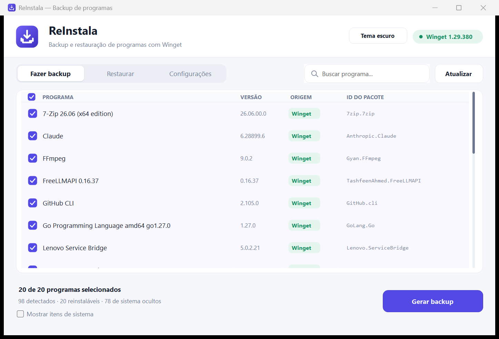
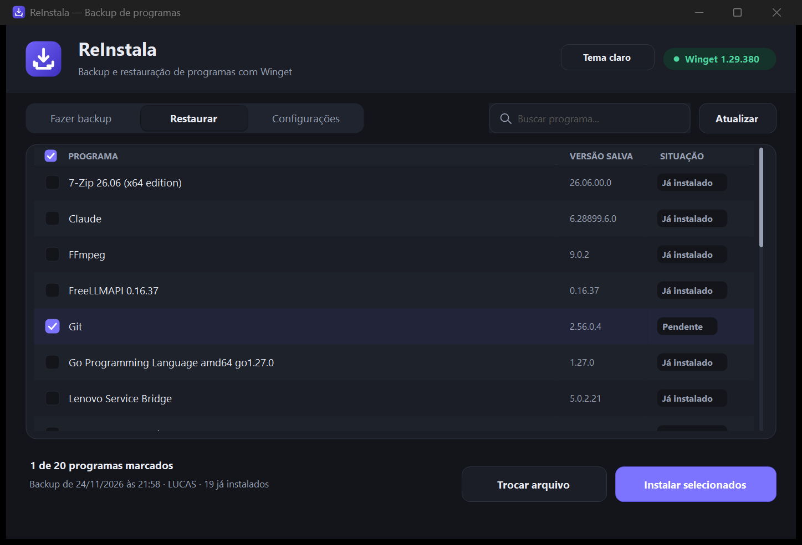
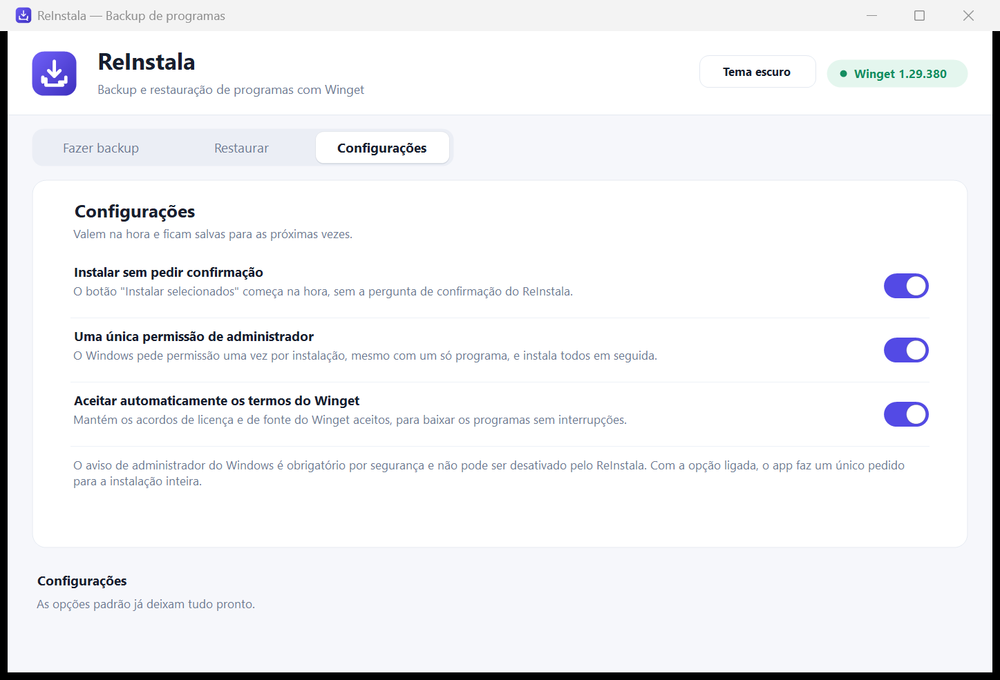
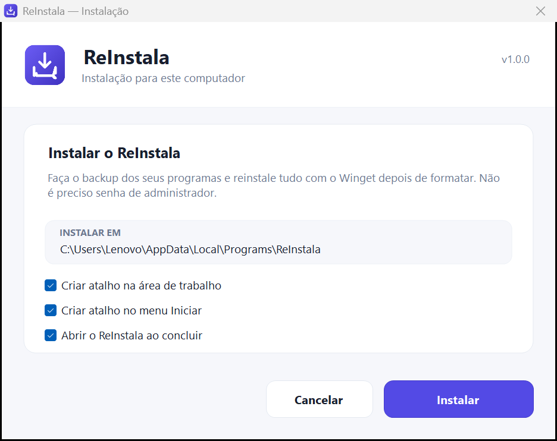

# ReInstala

**Back up your Windows programs and reinstall all of them after a clean install — no terminal, one file, one click.**

[Português (Brasil)](README.pt-BR.md) · [Download](../../releases/latest) · [Report a bug](../../issues)

Windows 10/11 · .NET Framework 4.8 (built in) · Winget · MIT License



## Why ReInstala?

Formatting a PC is easy. Reinstalling dozens of programs afterwards is not. ReInstala reads
everything installed on the machine, saves a tiny JSON file with the list, and reinstalls it all
later through [Winget](https://learn.microsoft.com/windows/package-manager/) — with a single
administrator prompt for the whole batch.

- No terminal, no scripts to edit, no download pages to hunt down.
- The backup is a small, readable JSON file (a few KB) with no personal data.
- Everything runs locally. Nothing is uploaded anywhere.

## Features

- **Instant start** — the last detected list is cached, so the window opens right away and
  refreshes the detection in the background.
- **One-click backup** — saves `ReInstala-Backup-YYYY-MM-DD_HH-mm.json` to your **Downloads**
  folder, containing only program names, Winget IDs and versions.
- **One-click restore** — pick the JSON file (or drag it onto the window), review the list, and
  reinstall everything with live per-app progress.
- **One administrator prompt per installation** — all selected apps are installed by a single
  elevated helper instead of one UAC prompt per program.
- **Settings tab with everything already enabled** — skip the confirmation dialog, group the
  elevation, and accept Winget license/source agreements automatically. Each option can be turned
  off.
- **Light and dark theme**, saved between sessions.
- **Search, select-all and system items toggle**, plus reliable mouse-wheel scrolling.
- **Small and dependency-free** — a single `.exe` built for .NET Framework 4.8, which ships with
  Windows. No installer framework, no runtime to download.

<!-- Screenshots side by side look bad on narrow screens, so they stay stacked. -->
<details>
<summary>More screenshots</summary>







</details>

## Download

Go to the [latest release](../../releases/latest) and pick one:

| File | What it is |
| --- | --- |
| **ReInstala-Setup.exe** *(recommended)* | Installs ReInstala for your user, creates a **desktop shortcut** and a Start Menu entry, and registers it in *Apps & features* so you can uninstall it normally. **No administrator rights required.** |
| **ReInstala.exe** | Portable single file. Run it from anywhere; nothing is installed. |

The executables are not code-signed, so Windows SmartScreen may show a warning the first time.
Click **More info → Run anyway**. The full source code is in this repository, and every release is
built from it by the [release workflow](.github/workflows/release.yml).

### Requirements

- Windows 10 (1809 or newer) or Windows 11.
- **Winget** (App Installer). If it is missing, ReInstala offers to install it for you.
- Internet access to download the programs.

## How to use

> The app interface is in Brazilian Portuguese. Button labels are shown here in English with the
> original text in parentheses.

### Before formatting

1. Open **ReInstala**.
2. Review the list. Items in gray cannot be reinstalled by Winget (Microsoft Store/MSIX apps and
   legacy registry entries); they are shown for reference only.
3. Check or uncheck programs (click the **PROGRAM** header to select all). Use the search box to
   filter and **Show system items** (`Mostrar itens de sistema`) to see libraries and system
   components.
4. Click **Create backup** (`Gerar backup`). The JSON file is saved to **Downloads**.

> Keep that file somewhere outside the computer — a flash drive, cloud storage or your email.
> It is everything you need after formatting.

### After formatting

1. Install Windows, then open the ReInstala installer (or the portable `.exe`).
2. Open the **Restore** tab (`Restaurar`) and click **Change file** (`Trocar arquivo`) — or drag the
   `.json` onto the window, or double-click the file if ReInstala is installed.
3. Review the list. Programs already installed are marked as **Already installed** and are not
   selected.
4. Click **Install selected** (`Instalar selecionados`) and wait. You can cancel at any time.

ReInstala asks for administrator permission **once per installation** — even when only one program
is selected — and installs everything in sequence. Approve the first prompt. If you decline, the
installation is cancelled and nothing is changed; click **Install selected** again to retry.
Some programs open their own setup wizard; just follow it.

## Settings

The **Settings** tab (`Configurações`) holds the permissions ReInstala handles for you. All three
options are on by default and take effect immediately:

| Option | Default | What it does |
| --- | --- | --- |
| **Install without asking for confirmation** (`Instalar sem pedir confirmação`) | On | Starts installing right away, without ReInstala's own confirmation dialog. |
| **Single administrator permission** (`Uma única permissão de administrador`) | On | Groups the whole installation behind one UAC prompt, even for a single program. |
| **Accept Winget terms automatically** (`Aceitar automaticamente os termos do Winget`) | On | Keeps Winget's license and source agreements accepted so downloads never stop. |

The Windows administrator prompt itself cannot be disabled by ReInstala — it is required by the
operating system. What the app does is ask for it only once per batch. If **Single administrator
permission** is turned off, a single selected program installs directly (Windows will only prompt
if that installer requires it).

## How it works

- Installed programs are read from `winget list` and parsed by the header columns, so names with
  spaces or non-ASCII characters are handled correctly.
- Only packages with a Winget ID are marked as restorable.
- The list and the Winget version are cached in `%LOCALAPPDATA%\ReInstala`, which is why the app
  opens instantly and only refreshes when the cache is older than two minutes.
- Installation runs `winget install --id <id> --exact` with the agreements configured in Settings.
  When elevation is needed, a single PowerShell helper installs all selected packages and streams
  progress back to the window.
- The theme and permissions are stored in `%LOCALAPPDATA%\ReInstala\settings.json`.

## Building from source

No Visual Studio, MSBuild or .NET SDK is needed — just Windows with .NET Framework 4.x, which
includes `csc.exe`.

```powershell
# Build the portable app -> dist\ReInstala.exe
powershell -ExecutionPolicy Bypass -File .\build.ps1

# Build the installer, which embeds the app -> dist\ReInstala-Setup.exe
powershell -ExecutionPolicy Bypass -File .\build-installer.ps1
```

The version number lives in [`version.txt`](version.txt). The icon is generated from
[`assets/make-icon.ps1`](assets/make-icon.ps1) (all sizes, from 16 to 256 px) and embedded into both
executables. Build output goes to `dist/`, which is not committed.

### Command line

| Command | Description |
| --- | --- |
| `ReInstala.exe --backup [path]` | Creates a backup without opening the window. Useful for scheduled tasks. |
| `ReInstala.exe --selftest [path]` | Runs a diagnostic report (detection, parsing, backup round-trip). |
| `ReInstala-Setup.exe --quiet` | Silent per-user installation with desktop and Start Menu shortcuts. |
| `ReInstala-Setup.exe --uninstall [--quiet]` | Removes the installed app, shortcuts and registry entry. |

## Project structure

| Path | Responsibility |
| --- | --- |
| `src/Program.cs` | Entry point, command-line modes and crash log |
| `src/MainForm.cs` | Main window, tabs, startup, install flow and theme |
| `src/AppList.cs` | Hand-drawn program list (check boxes, chips, scrolling) |
| `src/Controls.cs` | Buttons, search box, chips, progress bar, tabs, cards |
| `src/SettingsView.cs` | Settings tab with the automation toggles |
| `src/Settings.cs` | Saved preferences and local data paths |
| `src/Winget.cs` | Winget discovery, process execution, list parsing and install |
| `src/BatchInstaller.cs` | Single elevated helper that installs a whole batch |
| `src/WingetCache.cs` | Last detected list cache, so the window opens instantly |
| `src/BackupStore.cs` | Backup model, Downloads folder and JSON encoding |
| `src/BackupCli.cs` | `--backup` mode for scheduled backups |
| `src/SelfTest.cs` | `--selftest` diagnostic report |
| `src/Theme.cs` | Colors, fonts and drawing for light/dark themes |
| `src/NativeTheme.cs` | Dark mode for native Windows controls |
| `src/ListScrollBar.cs` | Themed scroll bar drawn over the native one |
| `src/WheelRouter.cs` | Routes the mouse wheel to the list even when it is not focused |
| `src/app.manifest` | DPI awareness and execution level |
| `installer/Setup.cs` | Per-user installer, shortcuts and uninstaller |
| `assets/` | Icon sources and generated `.ico` |
| `docs/` | Screenshots used in this README |
| `build.ps1` / `build-installer.ps1` | Build scripts |

## Backup format

```json
{
  "aplicativo": "ReInstala",
  "formato": 1,
  "geradoEm": "2026-11-24T21:58:00",
  "computador": "LUCAS",
  "sistema": "Microsoft Windows NT 10.0.26300.0",
  "winget": "1.29.380",
  "programas": [
    {
      "nome": "7-Zip 26.06 (x64 edition)",
      "id": "7zip.7zip",
      "versao": "26.06.00.0",
      "fonte": "winget"
    }
  ]
}
```

## Limitations

- Only packages available in Winget can be reinstalled automatically. Microsoft Store (MSIX)
  apps and legacy registry entries are shown for reference only.
- Restored programs use the latest version available in Winget, not necessarily the saved version.
- Programs with their own installers may require clicks in their setup wizard.
- The backup does not store licenses, accounts, settings or program files.
- The binaries are unsigned, so SmartScreen can warn on first run.

## Contributing

Contributions are welcome. Please read [CONTRIBUTING.md](CONTRIBUTING.md) before opening a pull
request, and use the issue templates for bugs and feature requests.

## License

[MIT](LICENSE) © 2026 ReInstala contributors.

ReInstala is an independent project and is not affiliated with Microsoft. Windows and Winget are
trademarks of Microsoft Corporation.
