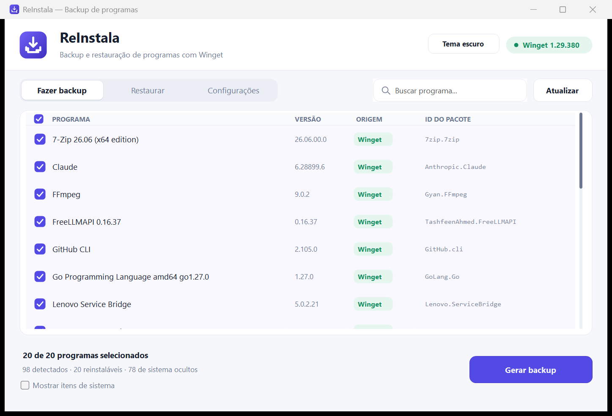
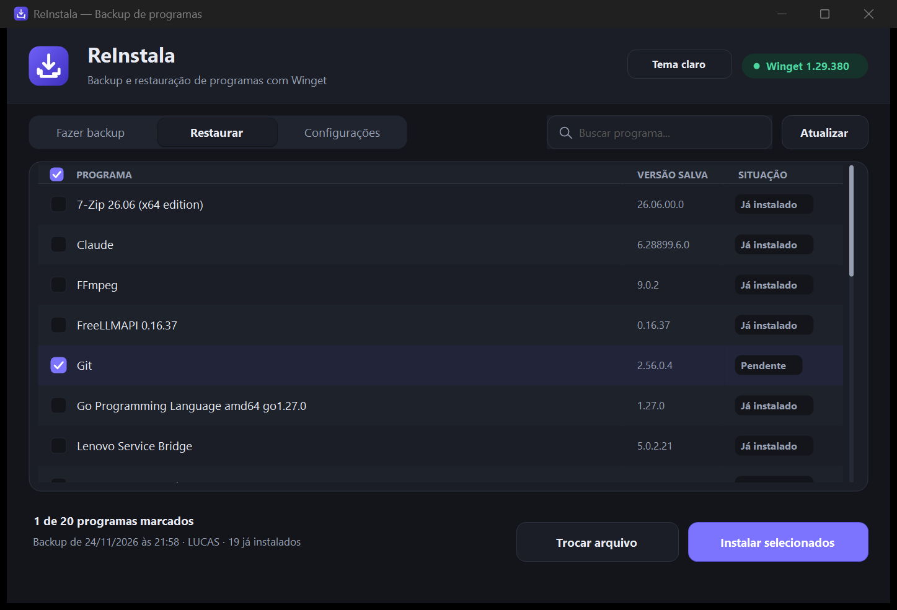
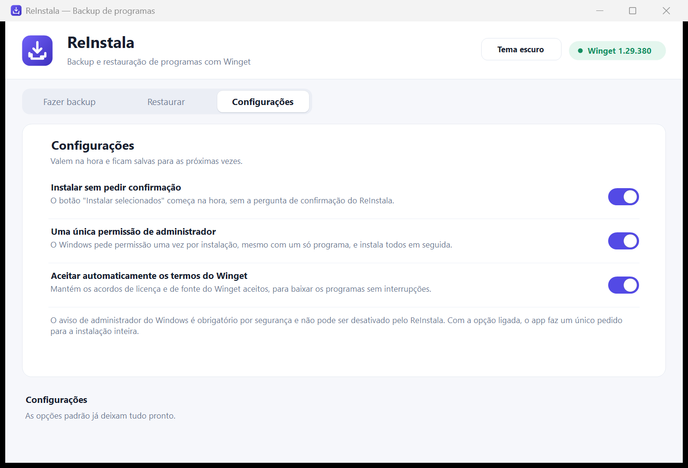
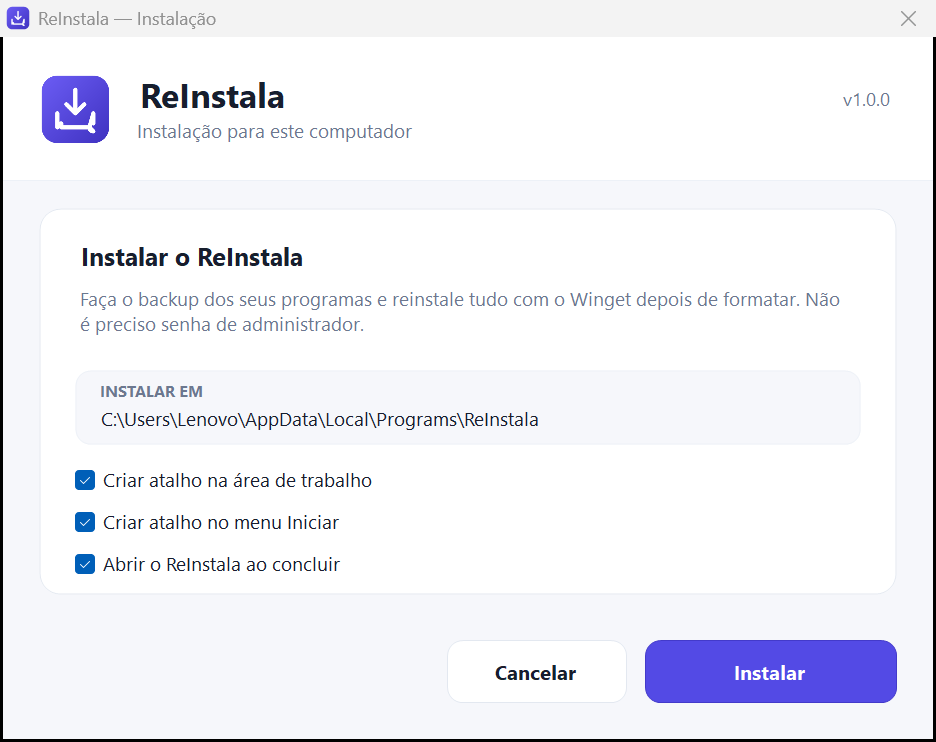

# ReInstala

**Faça backup dos programas do Windows e reinstale todos depois de formatar — sem terminal, um arquivo, um clique.**

[English](README.md) · [Baixar](../../releases/latest) · [Relatar um problema](../../issues)

Windows 10/11 · .NET Framework 4.8 (já incluído) · Winget · Licença MIT



## Por que existe

Formatar o computador é fácil. Reinstalar dezenas de programas depois é que dá trabalho. O ReInstala
lê tudo o que está instalado, salva uma lista em um JSON pequeno e depois reinstala tudo pelo
[Winget](https://learn.microsoft.com/windows/package-manager/) com **um único pedido de
administrador** para o lote inteiro.

- Sem terminal, sem editar scripts, sem caçar páginas de download.
- O backup é um JSON pequeno e legível (poucos KB), sem dados pessoais.
- Tudo roda localmente. Nada é enviado para a internet.

## Recursos

- **Abertura instantânea** — a última lista detectada fica em cache, então a janela abre na hora e
  atualiza a detecção em segundo plano.
- **Backup em um clique** — salva `ReInstala-Backup-AAAA-MM-DD_HH-mm.json` na pasta **Downloads**,
  com nome, ID do Winget e versão de cada programa.
- **Restauração em um clique** — escolha o JSON (ou arraste para a janela), revise a lista e
  reinstale tudo com progresso e status por programa.
- **Um pedido de administrador por instalação** — todos os programas marcados são instalados por um
  único ajudante elevado, em vez de um UAC por programa.
- **Aba Configurações com tudo já ligado** — pular a confirmação, agrupar a permissão e aceitar os
  termos/fonte do Winget automaticamente. Cada opção pode ser desligada.
- **Tema claro e escuro**, salvos entre sessões.
- **Busca, marcar tudo e itens de sistema**, com rolagem de roda do mouse confiável.
- **Pequeno e sem dependências** — um único `.exe` para .NET Framework 4.8, que já vem no Windows.

<details>
<summary>Mais capturas de tela</summary>







</details>

## Download

Abra a [última versão](../../releases/latest) e escolha:

| Arquivo | O que é |
| --- | --- |
| **ReInstala-Setup.exe** *(recomendado)* | Instala o ReInstala para o seu usuário, cria o **atalho na área de trabalho** e um atalho no menu Iniciar, e registra o app em *Aplicativos e recursos* para desinstalar normalmente. **Não pede permissão de administrador.** |
| **ReInstala.exe** | Arquivo único portátil. Rode de qualquer pasta; nada é instalado. |

Os executáveis não têm assinatura digital, então o SmartScreen do Windows pode avisar na primeira
execução. Clique em **Mais informações → Executar assim mesmo**. Todo o código-fonte está neste
repositório e cada versão é compilada a partir dele pelo
[fluxo de release](.github/workflows/release.yml).

### Requisitos

- Windows 10 (1809 ou mais recente) ou Windows 11.
- **Winget** (Instalador de Aplicativo). Se faltar, o ReInstala oferece instalá-lo para você.
- Conexão com a internet para baixar os programas.

## Como usar

### Antes de formatar

1. Abra o **ReInstala**.
2. Confira a lista. Os itens em cinza não podem ser reinstalados pelo Winget (apps da Microsoft
   Store/MSIX e entradas antigas do registro); eles aparecem apenas para consulta.
3. Marque ou desmarque programas (clique no cabeçalho **PROGRAMA** para marcar/desmarcar tudo).
   Use a busca para filtrar e **Mostrar itens de sistema** para ver bibliotecas e componentes.
4. Clique em **Gerar backup**. O arquivo JSON será salvo em **Downloads**.

> Guarde esse arquivo fora do computador — pen drive, nuvem ou e-mail. É só ele que você precisa
> depois da formatação.

### Depois de formatar

1. Instale o Windows e abra o instalador do ReInstala (ou o `.exe` portátil).
2. Abra a aba **Restaurar** e clique em **Trocar arquivo** — ou arraste o `.json` para a janela, ou
   dê duplo clique no arquivo com o ReInstala instalado.
3. Revise a lista. Os programas já instalados aparecem como **Já instalado** e não são marcados.
4. Clique em **Instalar selecionados** e aguarde. Você pode cancelar a qualquer momento.

O ReInstala pede permissão de administrador **uma única vez por instalação** — mesmo quando só um
programa está marcado — e instala todos em sequência. Aprove o primeiro pedido. Se você recusar, a
instalação é cancelada e nada é alterado; clique em **Instalar selecionados** de novo para tentar
outra vez. Alguns programas abrem o próprio assistente de instalação; basta segui-lo.

## Configurações

A aba **Configurações** reúne as permissões que o ReInstala resolve sozinho. As três opções já vêm
ligadas e valem na hora:

| Opção | Padrão | O que faz |
| --- | --- | --- |
| **Instalar sem pedir confirmação** | Ligada | Começa a instalação direto, sem a pergunta de confirmação do ReInstala. |
| **Uma única permissão de administrador** | Ligada | Agrupa a instalação inteira em um único pedido do Windows, mesmo com um só programa. |
| **Aceitar automaticamente os termos do Winget** | Ligada | Mantém os acordos de licença e de fonte do Winget aceitos, para baixar sem interrupções. |

O aviso de administrador do Windows em si não pode ser desligado pelo ReInstala: ele é obrigatório
por segurança. O que o app faz é pedir uma vez por lote. Se **Uma única permissão de administrador**
estiver desligada, um único programa marcado instala direto (o Windows só pergunta se aquele
instalador precisar).

## Como funciona

- Os programas instalados são lidos de `winget list` e interpretados pelas colunas do cabeçalho,
  para lidar com nomes com espaços e acentos.
- Só pacotes com ID do Winget são marcados como reinstaláveis.
- A lista e a versão do Winget ficam em cache em `%LOCALAPPDATA%\ReInstala`, por isso o app abre
  na hora e só atualiza quando o cache tem mais de dois minutos.
- A instalação roda `winget install --id <id> --exact` com os acordos definidos nas Configurações.
  Quando é preciso elevar, um único ajudante em PowerShell instala o lote e envia o progresso para
  a janela.
- O tema e as permissões ficam em `%LOCALAPPDATA%\ReInstala\settings.json`.

## Compilando do código-fonte

Não é preciso Visual Studio, MSBuild nem SDK do .NET — só o Windows com .NET Framework 4.x, que
inclui o `csc.exe`.

```powershell
# Compila o app portátil -> dist\ReInstala.exe
powershell -ExecutionPolicy Bypass -File .\build.ps1

# Compila o instalador, que embute o app -> dist\ReInstala-Setup.exe
powershell -ExecutionPolicy Bypass -File .\build-installer.ps1
```

O número da versão fica em [`version.txt`](version.txt). O ícone é gerado por
[`assets/make-icon.ps1`](assets/make-icon.ps1) (todos os tamanhos, de 16 a 256 px) e embutido nos
dois executáveis. A saída fica em `dist/`, que não é versionada.

### Linha de comando

| Comando | Descrição |
| --- | --- |
| `ReInstala.exe --backup [arquivo]` | Gera um backup sem abrir a janela. Útil em tarefas agendadas. |
| `ReInstala.exe --selftest [arquivo]` | Gera um relatório de diagnóstico (detecção, leitura, ida e volta do backup). |
| `ReInstala-Setup.exe --quiet` | Instalação silenciosa para o usuário, com atalhos na área de trabalho e no menu Iniciar. |
| `ReInstala-Setup.exe --uninstall [--quiet]` | Remove o app instalado, os atalhos e a entrada do registro. |

## Estrutura do projeto

| Caminho | Responsabilidade |
| --- | --- |
| `src/Program.cs` | Ponto de entrada, modos de linha de comando e log de falhas |
| `src/MainForm.cs` | Janela principal, abas, abertura, fluxo de instalação e tema |
| `src/AppList.cs` | Lista de programas desenhada à mão (caixas, chips, rolagem) |
| `src/Controls.cs` | Botões, busca, chips, progresso, abas e cartões |
| `src/SettingsView.cs` | Aba Configurações com os interruptores de permissão |
| `src/Settings.cs` | Preferências salvas e caminhos locais |
| `src/Winget.cs` | Localização do Winget, execução, leitura da lista e instalação |
| `src/BatchInstaller.cs` | Ajudante elevado único que instala o lote inteiro |
| `src/WingetCache.cs` | Cache da última lista, para abrir o app na hora |
| `src/BackupStore.cs` | Modelo do backup, pasta Downloads e JSON |
| `src/BackupCli.cs` | Modo `--backup` para backups agendados |
| `src/SelfTest.cs` | Relatório de autoteste (`--selftest`) |
| `src/Theme.cs` | Cores, fontes e desenho dos temas claro e escuro |
| `src/NativeTheme.cs` | Modo escuro dos controles nativos do Windows |
| `src/ListScrollBar.cs` | Barra de rolagem desenhada no tema |
| `src/WheelRouter.cs` | Encaminha a roda do mouse para a lista mesmo sem foco nela |
| `src/app.manifest` | DPI e nível de execução |
| `installer/Setup.cs` | Instalador por usuário, atalhos e desinstalador |
| `assets/` | Ícone (fonte e `.ico` gerado) |
| `docs/` | Capturas de tela usadas nos READMEs |
| `build.ps1` / `build-installer.ps1` | Scripts de compilação |

## Formato do backup

```json
{
  "aplicativo": "ReInstala",
  "formato": 1,
  "geradoEm": "2026-11-24T21:58:00",
  "computador": "LUCAS",
  "sistema": "Microsoft Windows NT 10.0.26300.0",
  "winget": "1.29.380",
  "programas": [
    {
      "nome": "7-Zip 26.06 (x64 edition)",
      "id": "7zip.7zip",
      "versao": "26.06.00.0",
      "fonte": "winget"
    }
  ]
}
```

## Limitações

- Só é possível reinstalar automaticamente o que existe no Winget. Apps da Microsoft Store (MSIX)
  e programas antigos sem identificador no Winget aparecem apenas para consulta.
- A versão reinstalada é a mais recente disponível no Winget, não necessariamente a versão salva.
- Programas com instalador próprio podem exigir cliques no assistente.
- O backup não guarda licenças, contas, configurações nem arquivos dos programas.
- Os executáveis não são assinados, então o SmartScreen pode avisar na primeira execução.

## Contribuindo

Contribuições são bem-vindas. Leia o [CONTRIBUTING.md](CONTRIBUTING.md) antes de abrir um pull
request e use os modelos de issue para relatar problemas ou sugerir recursos.

## Licença

[MIT](LICENSE) © 2026 ReInstala contributors.

O ReInstala é um projeto independente e não tem vínculo com a Microsoft. Windows e Winget são marcas
da Microsoft Corporation.
